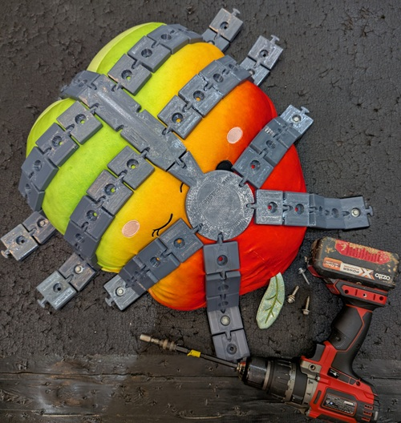
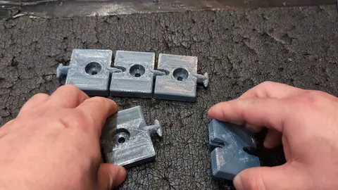
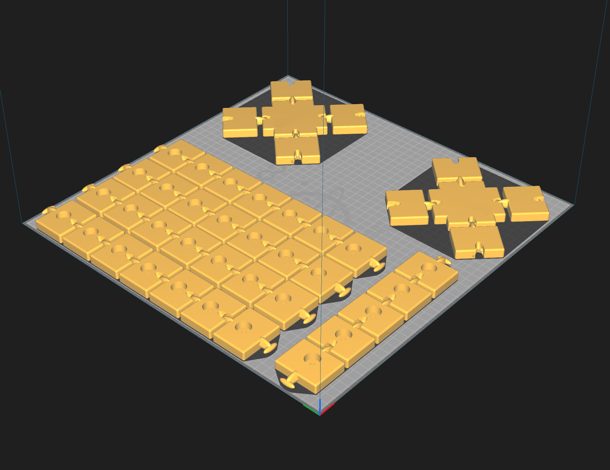

A system of 3D printable flexible straps, suitable to be interconnected into intricate designs and drilled into surfaces to hold still whatever you want to remain stationary.

This squishmellow aint going nowhere:



To connect these together - rotate down 90 degrees, 
then twist 90 degrees, and shove the prong into the
socket, reverse the twist, and then rotate flat.



# Get the STLs:

The STL files are ~20gb, so aren't offered as a download, it's quicker to build the stl's from the raw specs. 

1. Download the codebase.
2. extract it somewhere handy
3. download and install Python from python.org.
4. (optional) Download and install OpenSCAD. 
  
If the latest version is 2021.01, then download the nightly build instead, and enable the new Manifold geometry engine in preferences, it's 100x faster.

### Windows users:

After following the above, right click on "Build.py" and select "Open With -> Python". 

If it doesn't show `Python` in the list, be sure you downloaded and installed python correctly.

If that doesn't work, press WIN-R, type CMD, press enter, and in the black console window follow the below steps. 

### Everyone else:

In a new terminal window, type:

```
cd "C:\Path\To\Where\You\Extraced\This"
python build.py
```

# 3D print

Configure your slicer:
- Filament: PETG
- Infill: 100%
- Support: None
- Adhesion: Skirt
- Hotplate: 70 degrees.
- Nozzle: 260 degrees.
- Draft Shield: 10mm, unless you have an enclosed print volume.
- Filament preperation: 8 hours at 60 degrees.

Avoid brim and raft modes, these create sharp points which can damage whatever it
is you wish to immobilise.

I've tested this sliced with Cura 5.6 and printed on:
- Elegoo Neptune Max 4
- Anycubic i3 Chiron



